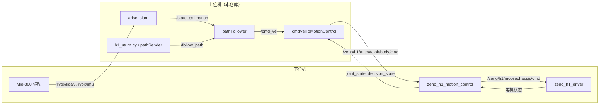

# ROS Path Following

Zeno H1 的路径跟随。机器人用激光-惯性 SLAM（arise_slam）定位，由 `pathFollower` 跟随路径，通过 `zeno_h1_motion_control` 驱动底盘。仓库里还带了一个仿真车，没有机器人时也能测试。

测试环境：**Ubuntu 24.04**，**ROS 2 Jazzy**。

## 系统架构

工作分在两台电脑上：**下位机**负责硬件，**上位机**运行本仓库。



1. **下位机：感知。** Mid-360 驱动把点云发布到 `/livox/lidar`，把雷达自带的 IMU 发布到 `/livox/imu`。
2. **上位机：状态估计。** arise_slam 直接订阅 `/livox/lidar` 和 `/livox/imu`，把机器人位姿发布到 `/state_estimation`。
3. **上位机：路径跟随。** `pathFollower` 比较当前位姿和 `/follow_path` 上的路径，在 `/cmd_vel` 上发布速度（车体坐标系下的前进、横移速度和角速度）。
4. **上位机：指令转换。** `cmdVelToMotionControl` 把 `/cmd_vel` 转成 motion_control 的 AUTO 指令，发布到 `/zeno/h1/auto/wholebody/cmd`。
5. **下位机：执行。** `zeno_h1_motion_control` 对指令做平滑后发给 `zeno_h1_driver`，由它通过 CAN 驱动电机。

### 两台电脑之间的话题

| 方向 | 话题 | 类型 | 说明 |
| --- | --- | --- | --- |
| 下位机 → 上位机 | `/livox/lidar` | `livox_ros_driver2/CustomMsg` | Livox 点云，每个点带相对时间戳 |
| 下位机 → 上位机 | `/livox/imu` | `sensor_msgs/Imu` | Livox 原始 IMU，加速度单位为 g |
| 上位机 → 下位机 | `/zeno/h1/auto/wholebody/cmd` | `std_msgs/Float64MultiArray` | 24 个字段：`[mode, 躯干×4, 左臂×7, 右臂×7, 夹爪×2, vx, vy, wz]` |
| 下位机 → 上位机 | `/zeno/h1/wheelarm/{torso,left_arm,right_arm}/joint_state`、`/zeno/h1/{left,right}_gripper/joint_state` | `sensor_msgs/JointState` | 实测关节位置，用来填 AUTO 指令里的手臂字段 |
| 下位机 → 上位机 | `/zeno/h1/motion/decision_state` | `zeno_h1_msgs/MotionDecisionState` | motion_control 当前处于哪个模式 |

AUTO 是 motion_control 里优先级最低的模式，手柄、VR、全身遥操随时都能从路径跟随手里接管控制。

### 网络

- 两台电脑要用相同的 `ROS_DOMAIN_ID` 和 RMW 实现，并且网络互通。建议用有线网口，点云每秒有几 MB。
- 两台电脑的时钟要同步（比如用 chrony）。SLAM 的输入都来自下位机，但 RViz 和录下来的数据会混用两台机器的时间戳。

## 软件包

| 包 | 运行在 | 说明 |
| --- | --- | --- |
| `path_follower` | 上位机 | 根据 `/state_estimation` 跟随 `/path` 上的路径（在机器人上重映射为 `/follow_path`），发布 `/cmd_vel` |
| `path_sender` | 上位机 | 从文本文件读取路径，依次发布 |
| `h1_bringup` | 上位机 | 机器人用的 launch 文件、`cmdVelToMotionControl` |
| `arise_slam_mid360`、`arise_slam_mid360_msgs` | 上位机 | 激光-惯性 SLAM，发布 `/state_estimation` 和 TF `map` → `sensor`（来自 autonomy_stack_malo） |
| `livox_ros_driver2` | 上位机 | 只包含 Livox 的消息定义（`CustomMsg`），驱动本身在下位机上运行 |
| [`src/slam/dependency`](src/slam/dependency) | 上位机 | arise_slam 用到的 Sophus 1.1、Ceres 2.2、GTSAM 4.3 源码。它们不是 ROS 包，colcon 会跳过 |
| `vehicle_simulator` | 上位机 | 带 RViz 的仿真车，没有机器人时用来测试 |

下位机运行 `zeno_h1_driver`、`zeno_h1_motion_control` 和 Livox 驱动，它们都在各自的仓库里。

## 上位机配置

### 1. 依赖

- **`zeno_h1_msgs`**：用 ROS 2 分支（`dev/ros2`；`master` 是 ROS 1），放在本工作空间的 `src/` 里或者 underlay 里。上位机只需要它的消息定义。
- **系统包：**

  ```bash
  sudo apt install libeigen3-dev libgoogle-glog-dev libgflags-dev libatlas-base-dev libsuitesparse-dev \
    libboost-all-dev libtbb-dev libpcl-dev \
    ros-jazzy-pcl-conversions ros-jazzy-pcl-ros ros-jazzy-cv-bridge ros-jazzy-image-transport ros-jazzy-tf2-geometry-msgs
  ```

- **Sophus、Ceres、GTSAM**：从 [`src/slam/dependency`](src/slam/dependency) 编译，按下面的顺序安装到系统里。每台电脑只需要做一次：

  ```bash
  cd src/slam/dependency/Sophus
  mkdir build && cd build
  cmake .. -DBUILD_TESTS=OFF
  make -j6 && sudo make install

  cd ../../ceres-solver
  mkdir build && cd build
  cmake .. -DBUILD_TESTING=OFF -DBUILD_EXAMPLES=OFF
  make -j6 && sudo make install

  cd ../../gtsam
  mkdir build && cd build
  cmake .. -DGTSAM_USE_SYSTEM_EIGEN=ON -DGTSAM_BUILD_WITH_MARCH_NATIVE=OFF
  make -j6 && sudo make install
  sudo /sbin/ldconfig
  ```

  `build` 目录已经被 git 忽略。GTSAM 编译最久；如果内存不够，把 `-j` 调小。

### 2. 编译

```bash
colcon build --cmake-args -DCMAKE_BUILD_TYPE=Release
source install/setup.sh
```

如果开着 conda，要在 `--cmake-args` 里加上 `-DPython3_EXECUTABLE=/usr/bin/python3`，否则生成消息时会报 `No module named 'em'`。

## 在机器人上运行

### 下位机

按平常的方式启动下面这些，并确认它们在发布：

- Mid-360 驱动：`/livox/lidar`、`/livox/imu`
- `zeno_h1_driver`，并使能底盘电机
- `zeno_h1_motion_control`：`/zeno/h1/motion/decision_state` 和各个 joint_state 话题

### 上位机

每一步开一个终端，每个终端都先 source 工作空间：

| 步骤 | 命令 | 发布 |
| --- | --- | --- |
| 1 | `ros2 launch h1_bringup slam.launch.py` | `/state_estimation`、TF `map` → `sensor` |
| 2 | `ros2 launch h1_bringup follower.launch.py sensorOffsetX:=<m> sensorOffsetY:=<m>` | `/cmd_vel` |
| 3 | `ros2 launch h1_bringup bridge.launch.py` | `/zeno/h1/auto/wholebody/cmd` |
| 4 | 发送路径（见下文） | `/follow_path` |

- **启动 SLAM 时机器人要在起点。** 地图原点就是 SLAM 启动时雷达所在的位置。
- **`sensorOffsetX/Y`** 是雷达相对底盘中心的位置，分别是向前和向左，单位米。
- **雷达输入。** arise_slam 直接订阅下位机的话题，中间没有转换节点。用 `ros2 topic info -v /livox/lidar` 确认两点：
  - 类型是 `livox_ros_driver2/msg/CustomMsg`（Livox 驱动 `xfer_format: 1`）。arise_slam 的 livox 模式只收这种格式，`PointCloud2` 收不到。
  - 发布端 QoS 是 `RELIABLE`。arise_slam 用 RELIABLE 订阅，收不到 BEST_EFFORT 的数据。
  - 话题名不同时用 `lidar_topic:=...`、`imu_topic:=...` 指定。

### 发送路径

路径在 SLAM 的 `map` 坐标系下。[scripts](scripts) 里的脚本默认用 FAST-LIO 的 `/Odometry`，所以要加 `--odom /state_estimation`：

```bash
# 从当前位姿生成 U 型掉头路径：前进 1 m，掉头半圆，再返回 1 m
python3 scripts/h1_uturn.py --odom /state_estimation            # 只预览，写到 h1_paths_uturn/path.txt
python3 scripts/h1_uturn.py --odom /state_estimation --send     # 发送

# 三条示例路径，平移到从当前位姿出发
python3 scripts/h1_paths.py --odom /state_estimation --scale 0.5
ros2 run path_sender pathSender --ros-args --params-file h1_paths/path_sender.yaml -r /path:=/follow_path

# 原样发送示例路径（从地图原点出发，朝 +x）
ros2 launch h1_bringup sender.launch.py

# 录制一次运行，画出规划路径和实际轨迹的对比
python3 scripts/record_run.py --odom /state_estimation
```

### Launch 参数

| Launch 文件 | 参数 | 默认值 |
| --- | --- | --- |
| `slam.launch.py` | `lidar_topic`、`imu_topic` | `/livox/lidar`、`/livox/imu` |
| `follower.launch.py` | `sensorOffsetX`、`sensorOffsetY` | `0.0`、`0.0` |
| | `speed`（m/s）、`yawRate`（rad/s） | `0.2`、`0.75` |
| | `path_topic` | `/follow_path` |
| `bridge.launch.py` | `maxLinear`（m/s）、`maxAngular`（rad/s） | `0.2`、`1.0` |
| | `checkOdom` | `true` |
| `sender.launch.py` | `path_topic`、`looping` | `/follow_path`、`false` |

## 安全

- **bridge 的停止条件。** `cmdVelToMotionControl` 只在以下条件都满足时，才以 50 Hz 发布 AUTO 指令：`/cmd_vel` 在 0.25 s 内更新过，`/state_estimation` 在 0.3 s 内更新过，并且收得到 joint_state。不满足时，它会连续 0.5 s 发送 mode 0，让 motion_control 把底盘速度清零并进入 IDLE，然后停止发布。按 Ctrl-C 退出时也一样。
- **软件急停。** `ros2 topic pub --once /chassis_estop std_msgs/msg/Bool "{data: true}"` 会用同样的方式释放 AUTO，并一直保持，直到发送 `{data: false}`。
- **手臂。** AUTO 指令同时设定躯干、手臂和夹爪的目标。bridge 用实测位置填这些字段，AUTO 控制期间保持这个姿态不变。
- **IDLE 时手臂会动。** motion_control 在 IDLE 状态下会把手臂目标设为全 0，所以路径跑完或者 bridge 释放 AUTO 后，手臂可能回到零位。这是 motion_control 自身的行为，第一次先在安全姿态下确认。
- **进程被强杀。** 如果上位机或 bridge 没来得及发 mode 0 就退出了（被强杀或者断网），motion_control（`feature/ros2` 分支）会保持最后一次的 AUTO 底盘速度。手边要有手柄或物理急停。
- **前几次运行。** 速度上限是 0.2 m/s，这也是驱动的上限。先跑短路径，周围不要有障碍物。

### 第一次运行前

arise_slam 的配置来自 malo 平台，下面这些要对照 H1 检查：

- `src/slam/arise_slam_mid360/config/livox_mid360.yaml` 里的 `lidar_pitch` 和盲区设置
- `src/slam/arise_slam_mid360/config/livox/livox_mid360_calibration.yaml` 里的 IMU 到雷达外参
- 雷达的正前方和底盘的正前方一致
- `sensorOffsetX/Y`

## 仿真

没有机器人时，只编译仿真相关的包，然后启动仿真：

```bash
colcon build --cmake-args -DCMAKE_BUILD_TYPE=Release --packages-select path_follower path_sender vehicle_simulator
source install/setup.sh
ros2 launch vehicle_simulator vehicle_simulator.launch
```

在 RViz 里应该能看到车依次跟随三条示例路径。仿真器订阅 `/cmd_vel`、发布 `/state_estimation`，替代了除 `pathFollower` 和 `pathSender` 以外的所有部分。

## 路径格式

- 路径文件在 [`src/path_sender/data`](src/path_sender/data)。
- 每行是路径上的一个点 `x y z`。
- 路径用间隔 10 cm 的密集点表示，建议间隔保持在 5 到 10 cm 之间。
- 每条路径至少要有 2 个点。
- 路径发给 `pathFollower` 时，终点朝向存在 `path.poses[pathSize - 1].pose.orientation` 里，也就是最后一个点的朝向。
